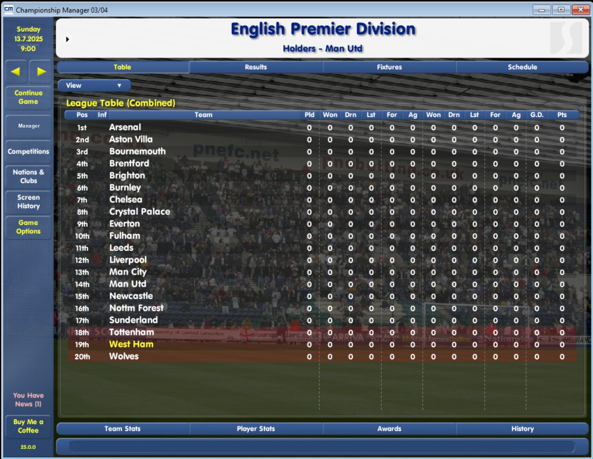
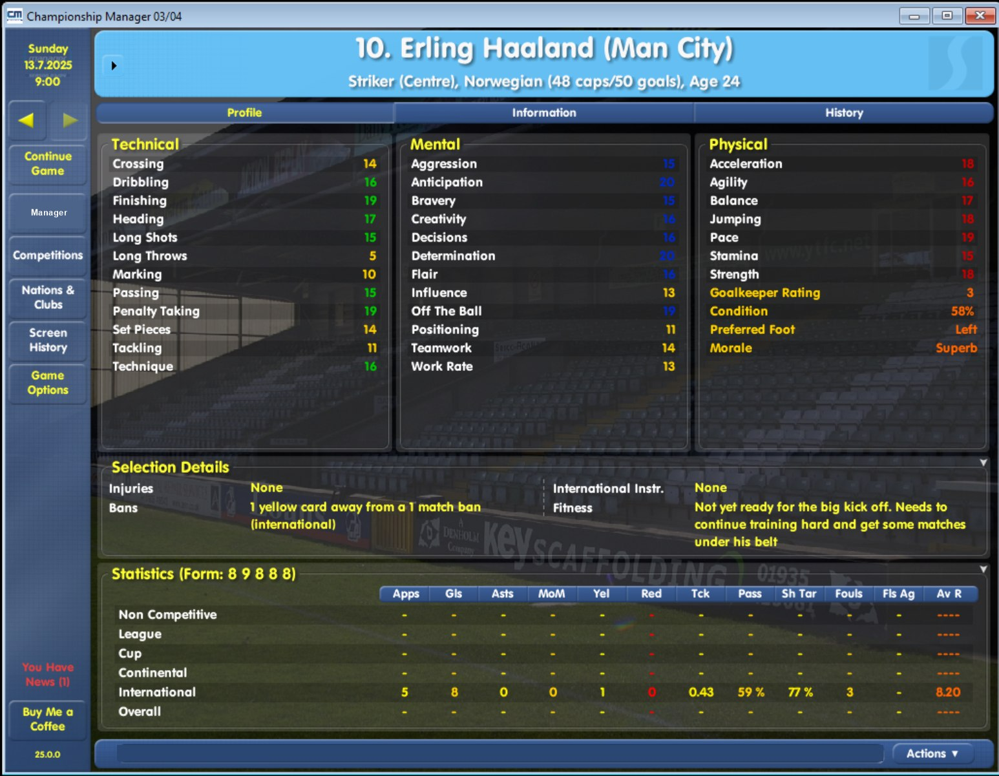
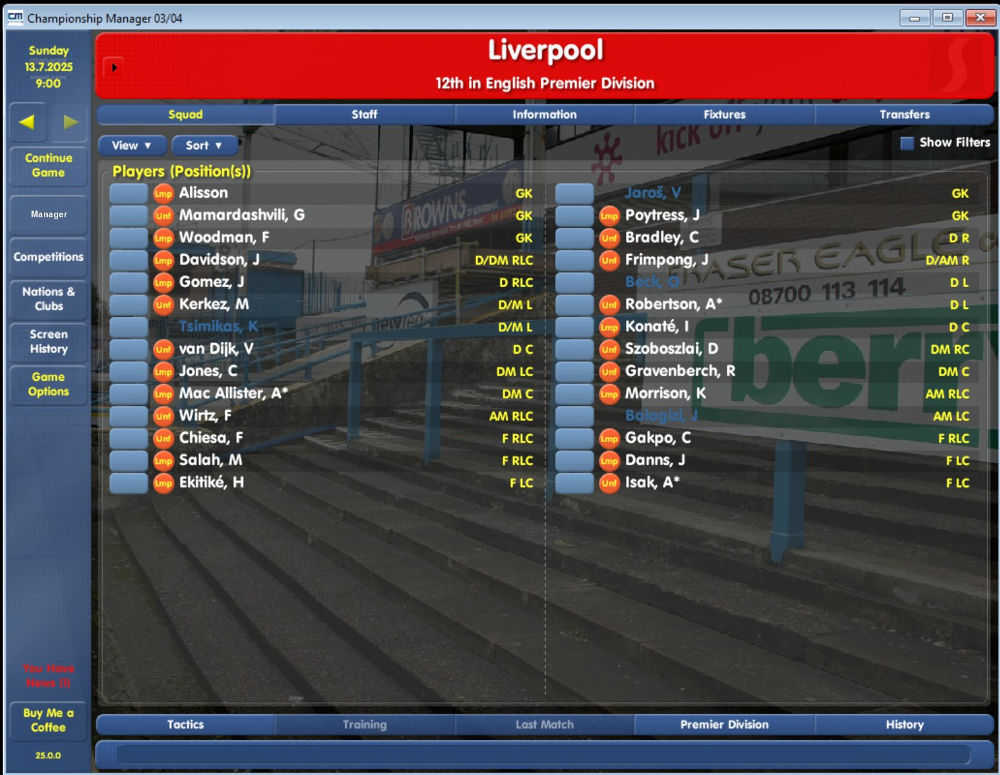

# CM 03/04 Modern

A fan-made, unofficial update that brings **Championship Manager 03/04** (version 4.1.5) into the 2026/27 football world: real clubs, real players and staff, current stadiums and finances, and modern squad rules.

> **Unofficial.** This project is fan-made. It is not affiliated with, endorsed by, or connected to the original developers or publishers of Championship Manager. See [NOTICE.md](NOTICE.md).

**Current version: 26.0.0** - the 2026/27 game. Download the installer from the [v26.0.0 release](../../releases/tag/v26.0.0). The 2025/26 game stays available as the 25.x line (newest: [25.1.2](../../releases/tag/v25.1.2)); see [which version do I need](docs/index.md#which-version-do-i-need-two-lines).

## What you get

- **A 2026/27 world.** More than 140,000 players and more than 48,000 staff, built from Football Manager 27 data for 30 nations: squads, ratings, contracts, loans, club reputations, finances, facilities and kit colours.
- **30 nations with real 2026/27 divisions and cups:** the 28 nations of the 25.x line (England, Spain, Italy, France, Germany, Scotland, Holland, Portugal, Switzerland, Turkey, Czech Republic, Sweden, Wales, Northern Ireland, Argentina, Brazil, Norway, Croatia, Republic of Ireland, Slovakia, Austria, Denmark, Poland, Hungary, Greece, Finland, Ukraine and Belgium) plus **Russia and Israel**. Details: [nations](docs/nations.md).
- **The real 2025/26 season behind it:** final tables, cup winners and UEFA coefficients decide the 2026/27 European places; history screens reach 2025/26 (league, cup, league cup and super cup winners with the runner-up, the Euro and the World Cup, the European competitions).
- **The modern UEFA formats** (36-club league phase, qualifying paths, coefficients screens, prize money) and the real 2026/27 UEFA calendar.
- **Modern squad rules:** 12 named players, 5 substitutes used in league and cup matches (friendlies allow 12 substitutions).
- **A Positions pitch** on the player profile, foreign-player limits per nation (where the game can express them), updated EU flags, national-team managers and a Contributors screen.
- **An optional update notice:** at most once a day the game tells you when a newer version of your own version line is out (26.x players are told about 26.x versions). It can be switched off. See [the update notice](docs/update-notice.md).

Not everything is perfect. Please read the [known issues](docs/known-issues.md) before you start.

## Screenshots

These were taken in the 2025/26 game (25.x); screenshots of the 2026/27 game will follow.







More in the [screenshots gallery](docs/screenshots.md).

## Requirements

- Windows 10 or 11.
- Championship Manager 03/04 updated to **version 4.1.5** (the official 4.1.5 patch, or a no-CD exe: any exe works, because the installer brings its own exe).
- The game folder must contain `cm0304.exe` and `data\db` with the four database files.
- The game (and the editor) must be **closed**, and the files must be writable.
- About 700 MB of free disk space.

This project does **not** include the game. You need your own copy.

## Install (3 steps)

1. Download `CM0304-Modern-26.0.0-Setup.exe` from the [v26.0.0 release](../../releases/tag/v26.0.0). (Optional: compare its SHA-256 with the one on the release page.)
2. Run it. It asks for administrator rights because the default game folder is under Program Files. Windows may show an "unknown publisher" (SmartScreen) warning, because the installer is not code-signed.
3. Pick your game folder (the folder that contains `cm0304.exe`; common locations are detected). Setup checks the folder, backs up the original files, installs, and verifies every file.

Then **start a new game**. 26.0.0 is the 2026/27 game: saves made with 25.x or earlier versions, or with the original game, do not load in it (your old saves stay in the folder).

**The game starts in full screen.** 26.0.0 keeps its settings under its own name, so your options from 25.x or from the original game do not carry over. To play in a window, open Preferences > Display Settings and untick **Full Screen** (or start `cm0304.exe` with the switch `-windowed`).

**New to this update?** The installer is complete (it contains the full database and every change). You do **not** need 25.x first: install it straight onto your CM 03/04 4.1.5 game.

**Upgrading from 25.x:** run the new installer on the same game folder and **start a new game**. To keep a 25.x game as well, install 26.0.0 into a copy of your game folder. To go back to 25.x, run `Uninstall CM 03-04 26.0.0.exe` from the game folder first, then the 25.x installer.

**Which version do I need?** 26.x is the 2026/27 game; 25.x is the 2025/26 game and keeps receiving bug fixes. See [which version do I need](docs/index.md#which-version-do-i-need-two-lines).

Silent install for advanced users:

```
CM0304-Modern-26.0.0-Setup.exe /S /D=C:\Program Files (x86)\Eidos\CM 03-04
```

Add `/noupdatecheck` to leave the update notice off (see [the update notice](docs/update-notice.md)). (`/D=` must be the last parameter. Exit code 0 means success. The log is `%TEMP%\CM0304-Modern-Setup.log`.)

## Uninstall

The installer copies the original files to `backup_pre_v25` inside your game folder. To go back, run `Uninstall CM 03-04 26.0.0.exe` from the game folder (or run the setup again with `/uninstall`). It verifies the backup, restores your files from before the update (your own exe included) byte for byte, and then removes the backup folder and the uninstaller itself. Your saves and other files are not touched. If an old backup exists from an earlier install, the installer archives it as `backup_pre_v25_old_<timestamp>` instead of blocking.

## What the installer changes

It **replaces `cm0304.exe`** with our modified executable (it carries the rule changes: substitutes, foreign-player limits, hidden nations, match speeds, the UEFA formats, year fixes and the 26/27 texts; no CD is needed afterwards). Your own exe is backed up byte for byte. The installer changes **42 entries**, nothing else: `cm0304.exe`, the 4 database files and 3 player-history files in `data\db`, two UEFA data files (`club_coef.dat` and `ccs_extra.dat`), three competition pictures, seven small pictures for the Positions pitch, five menu/community/profile XML files, the update helper `CM0304-UpdateCheck.exe`, the three speed-up files (`msvcr71.dll`, `MSVCR71_real.dll` and `cm_proxy.cfg`), and 13 old competition fixture files in `data\comps` (Belgium, France, Italy) that are removed (they go into the backup). Other exe-level mods are not kept while the update is installed.

The update helper (version 1.1.0) is added to the game folder; the uninstaller removes it and its small settings folder. The exe starts the helper at game start; it only looks for newer versions of your own version line (26.x players are told about 26.x versions). The helper is an unsigned program, so antivirus or SmartScreen may warn; it can be deleted or switched off and the game works without it. See [the update notice](docs/update-notice.md).

The installer refuses, changing nothing, only when the folder is clearly not a CM 03/04 folder, the game is running or files are not writable. An unusual exe length or database header only gives a warning.

## Help, questions, bugs

- Questions: see the [FAQ](docs/faq.md).
- Found a bug? Use [Issues](../../issues/new/choose) and pick the matching form. For crashes, please attach a crash dump: [how to report a bug](docs/report-a-bug.md).

## Disclaimer

Fan-made and unofficial. Not affiliated with or endorsed by the original developers or publishers. The installer contains a modified game executable and data files, and no other game files. See [NOTICE.md](NOTICE.md).

## License

The documentation and text in this repository are licensed under [CC BY 4.0](LICENSE). The game, the installer's executable and data, and the football data are not covered; see [NOTICE.md](NOTICE.md).
