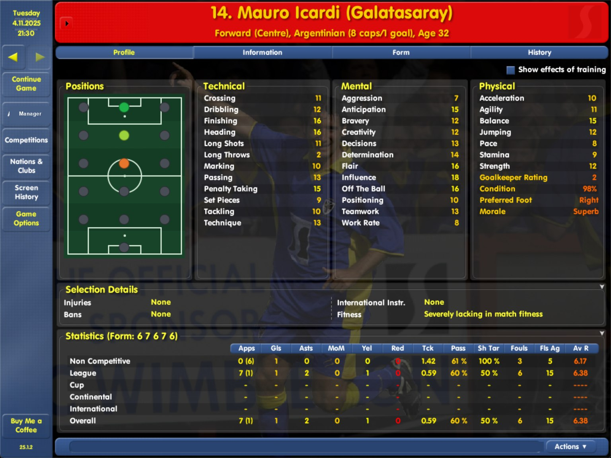

# CM 03/04 Modern

A fan-made, unofficial update that brings Championship Manager 03/04 (version 4.1.5) into the 2026/27 football world.

**Current version: 26.0.5** - [Download 26.0.5 from Releases](https://github.com/cm0304-modern/cm0304-modern/releases/tag/v26.0.5) (the 2026/27 game). The 2025/26 game is still available: [25.1.2](https://github.com/cm0304-modern/cm0304-modern/releases/tag/v25.1.2) is the newest 25.x release.

Pages: [FAQ](faq.md) | [Nations](nations.md) | [Known issues](known-issues.md) | [Update notice](update-notice.md) | [Changelog](changelog.md) | [Report a bug](report-a-bug.md) | [Screenshots](screenshots.md)

## Install guide (26.0.5, the 2026/27 game)

**Before you start**

- You need your own Championship Manager 03/04, **version 4.1.5** (updated with the official 4.1.5 patch, or a no-CD exe: any exe works), on Windows 10 or 11. The game folder must contain `cm0304.exe` and `data\db` with the four database files.
- Close the game and the editor.
- Have about 700 MB of free disk space.

**Steps**

1. Download `CM0304-Modern-26.0.5-Setup.exe` from the [release page](https://github.com/cm0304-modern/cm0304-modern/releases/tag/v26.0.5). You can check the download with PowerShell: `Get-FileHash .\CM0304-Modern-26.0.5-Setup.exe` and compare with the SHA-256 shown on the release.
2. Run the installer and accept the administrator prompt. If Windows SmartScreen says "unknown publisher", that is because the installer is not code-signed.
3. Choose the folder that contains `cm0304.exe`. Setup lists what it will change, backs up the originals to `backup_pre_v25`, installs and verifies every file.
4. Start the game and begin a **new game** (the new national team managers and the other data changes of 26.0.5 appear only in a new game; if you upgrade from 26.0.4, see below). 26.x is the 2026/27 game: saves from 25.x or earlier versions, or from the original game, do not work with it (they stay in your folder).

**The game starts in full screen.** 26.x keeps its settings under its own name ("Championship Manager 26/27"), so the options of your 25.x or original game do not carry over and the game starts in full screen. To play in a window, open **Preferences > Display Settings** and untick **Full Screen**, or start `cm0304.exe` with the switch `-windowed`.

**The installer replaces `cm0304.exe`** with our modified executable (it carries the rule changes). Your own exe is backed up byte for byte. No CD is needed afterwards.

**Upgrading from 26.0.0, 26.0.1 or 26.0.2:** run the new installer on the same game folder, then start a **new game** for the new data.

**Upgrading from 26.0.3:** run the new installer on the same game folder, then start a **new game** (a save of 26.0.3 does not get the new data of 26.0.4 and 26.0.5, and it shows wrong player careers with the corrected history files).

**Upgrading from 26.0.4:** run the new installer on the same game folder; it replaces `cm0304.exe`, the people and server database, the three player-history files and the community info screen. Saves made with 26.0.4 get the corrected player careers in place (tested on a game-start save); an existing 26.0.4 save keeps its old national team managers. The new national team managers and the other data changes appear only in a **new game**; starting one is recommended, not required.

**Upgrading from 25.x:** run the new installer on the same game folder and **start a new game**. Nothing of your 25.x saves is deleted. If you want to keep playing 25.x as well, install 26.0.5 into a copy of your game folder (the installer works on any folder that contains `cm0304.exe`).

**Going back to 25.x:** run `Uninstall CM 03-04 26.0.5.exe` from your game folder first (it restores your original files), then run the 25.x installer. Your 25.x saves are still in `user data\games`.

If the installer refuses, it has not changed anything. It refuses only when the folder is clearly not a CM 03/04 folder, the game is running or files are not writable.

**Uninstall:** run `Uninstall CM 03-04 26.0.5.exe` from your game folder. It restores your original files (your own exe included) from the backup and then removes the backup folder and itself.

## Which version do I need? (version lines)

CM 03/04 Modern has three version lines (25.x is discontinued), because the 2025/26 game and the 2026/27 game are different games:

- **26.x - the 2026/27 game** (this page's install guide): the 2026/27 season from Football Manager 27 data for 30 nations. Download it from the [v26.0.5 release](https://github.com/cm0304-modern/cm0304-modern/releases/tag/v26.0.5).
- **4.x - the original 2003/04 game with quality-of-life fixes**: the original database, plus a Simulate button, a Positions pitch that keeps its proportions, attribute colours, a faster 2D match engine and a speed-up runtime. Download it from the [v4.2.0 release](https://github.com/cm0304-modern/cm0304-modern/releases/tag/v4.2.0). It is not marked as the GitHub "latest release".
- **25.x - the 2025/26 game** (discontinued; newest 25.1.2): 2025/26 squads, clubs and competitions. Download it from the [v25.1.2 release](https://github.com/cm0304-modern/cm0304-modern/releases/tag/v25.1.2); all releases are on the [Releases page](https://github.com/cm0304-modern/cm0304-modern/releases). The GitHub latest release is the newest 26.x release.

26.x needs a new game; 4.x plays saves of the original game. Saves do not cross lines. To play two lines, use separate copies of the game folder. They keep their settings separately. The update notice only tells you about newer versions of **your own line**: 25.x players hear about 25.x versions, 26.x players about 26.x versions, 4.x players about 4.x versions.

## What's new in 26.0.5

**The player histories of 26.0.4 fixed, and national team managers from the Football Manager 27 database.** Saves made with 26.0.4 get the corrected careers in place (tested on a game-start save); saves from 26.0.3 or older show wrong careers with the corrected history files (a 26.0.3 save still showed the right careers in 26.0.4): start a new game, or keep 26.0.4 until you have finished such a save. The new national team managers and the other data changes appear only in a new game; starting one is recommended, not required. An existing 26.0.4 save keeps its old national team managers.

- **Player histories:** in 26.0.4 the History tab of most players showed the career of another player, because the history files shipped with 26.0.4 had been built for the player numbering of 26.0.3. 26.0.5 replaces them: 903,879 season rows for 120,741 players (6,272 more players have a history than before).
- **National team managers:** 188 national teams have a manager read from the Football Manager 27 database (179 in 26.0.4). Compared with 26.0.4 the database names a different manager for 82 teams (for example France: Zidane, Germany: Klopp, Italy: Mancini, Portugal: Jorge Jesus, Holland: Xavi, Belgium: van Bommel, Scotland: Pocognoli, Croatia: Bilic), a manager for 28 teams that had none (for example the Netherlands Antilles: Advocaat) and nobody for 16 teams: among them Mexico, Turkey and Ghana, where the game generates a manager when a new game starts, because the database has none. In a new game the preferred formation of every national team manager shows Unknown, 33 of the 188 have no attribute values in the database, and for nine nations the database names a manager without any ability data, so the game generates the manager there (six of those nine are among the 82 and 28 teams above). In a new game 84 teams keep their 26.0.4 manager, 78 get a different one and 26 get one where there was none (188 in all); Ethiopia, Chinese Taipei, Guyana and Vanuatu lose the real manager they had in 26.0.4.
- **Contributors:** the Contributors screen shows a second supporter.

Nothing else changed: the other database files, the other screens and the game programme are those of 26.0.4 (the version label differs). Not in this release: African competitions.

## What's new in 26.0.4

**A new-game release.** 26.0.4 reads the game's data directly from the Football Manager 27 database instead of from web pages, and adds several features. The save stream version stays 148. Saves made with 26.0.3 still load, but they do not get the new data: start a **new game** to see it.

- **Real referees:** 3,758 real referees from the Football Manager 27 data. Nations that have no referees in that data keep the officials they had before.
- **Manager formations and tactics:** 4,862 managers and coaches have a preferred formation (shown on the manager's profile, and the AI plays it), and about 1,300 of them have tactical tendencies such as marking, offside trap and sitting back.
- **Brazil, foreign players:** the Brazilian leagues (Serie A to D) and the Copa do Brasil now follow the current CBF rule: up to 9 foreign players on the match sheet and no limit on registered foreigners (the game used to allow 2 and 3).
- **Loans** come from the Football Manager 27 database, with the real loan club and end date: 5,295 players start the game on loan (3,500+ before), including nations that had none before.
- **First-team squads** are the usual 25 players (3 goalkeepers, 8 defenders and the best 14 others); clubs that used to start with 80 or more players, such as Boca Juniors, no longer do.
- **UEFA Club Coefficients screen:** a new yellow column before Total shows the points of the season being played; the Total and the ranking are unchanged.
- **Contributors:** the Contributors screen shows our first supporter.

Reserve squads exist only where the club already has such a team in the game database. Not in this release: African competitions.

## What's new in 26.0.3

**A new-game release.** 26.0.3 brings new squad, language and join-date data in the database. The save stream version stays 148. Saves made with 26.0.2 still load, but they do not get the new data: start a **new game** to see it.

- **Reserve and youth squads:** players are placed into the club's existing secondary team (B, C, II, U21 and so on) when their team name in the Football Manager 27 data ends with that team's type: 1,342 players in 96 clubs (Spain 699, Czech Republic 229, Germany 187, Switzerland 139, Portugal 66, Slovakia 15, Norway 4, New Zealand 3). No team is created; clubs without such a team are unchanged.
- **Spoken languages:** players speak the language of each nation where his club career lasted at least one season (23,213 players, 52,381 entries).
- **Join dates** come from the career history (83,370 players); players whose current club is not in their history join on 1 July 2026 (31,099 players); the 31,909 players without a history are unchanged. The game gives a foreign player the second nationality of his club's country after enough years at the club; with the new dates this follows real spells (for example Dusan Vlahovic, who joined Besiktas this season, no longer gets a Turkish second nationality, while players with a long real spell at a club still do).

Reserve squads exist only where the club already has such a team in the game database; the game still tops teams up with its own filler players and may re-sort them by age at the start of a game. Not in this release: African competitions.

## What's new in 26.0.2

**A new-game release.** 26.0.2 brings new history, record and contract data in the database and a changed save format (save stream version 148). Saves made with 26.0.1 still load, but they do not get the new data: start a **new game** to see it.

- **Tournament histories** for the national-team tournaments and the continental and Inter-Continental club cups, including the 2025 editions.
- **Player career histories:** the History tab of the players shows their real career (864,727 season rows for 114,469 players); clubs that are not loaded in your world show as Unknown Club.
- **Club and national-team records:** all 148 curated club records apply, including RB Leipzig, and 175 nations have their most-capped player.
- **Basque players** can again be signed by clubs with a Basque-only policy, such as Athletic Club.
- **Realistic contract end dates** (the game accepts end years up to 2048) and a **proportional Positions pitch** (55 pre-rendered sizes).
- **Update helper 1.2.0:** it tells you only about newer releases of your own line, and knows the separate 4.x line.

Not in this release: African competitions.

## What's new in 4.2.0 (the 4.x line, original database)

**The first release of the 4.x line.** It keeps the original 2003/04 database (no player, club or season data is changed) and adds: the **Simulate** button, the **proportional Positions pitch**, three-colour **attribute values**, a faster **2D match engine**, **12 named / 5 used** substitutes and a **speed-up runtime**. The save format (147) is unchanged: saves of the original game load, and CM Scout and other save tools keep working. The foreign-player limits and the EU flags are not included. The installer refuses a folder that has Modern installed (uninstall it first); Modern installers older than 26.0.2 have no such guard, so use the installer of the line you have installed.

## What's new in 26.0.1

**A Simulate button and three-colour attribute values.** The database is identical to 26.0.0: your **26.0.0 saves keep working** and no new game is needed.

- **Simulate.** The "Proceed to match?" window that opens when you click Go To Match has a new button, **Simulate**, to the left of No. It plays that one match with your current squad and tactics, without the match screen, and gives control back at midnight after the match day. The **Last Match** page of the simulated match then opens by itself (score, incidents, fixture), so you see the result at once. Yes and No work as before. If a selected player is banned or injured, the game shows its usual notice first and that window has no Simulate: replace the player and click Go To Match again.
- **Three-colour attribute values.** On the player profile the values of the attributes are white from 1 to 10, yellow from 11 to 15 and green from 16 to 20. The attribute names stay white.
- **Nothing else changes.** The update replaces `cm0304.exe` and the player profile screen file (`data\panels\player profile.xml`) and adds a changed "Proceed to match?" window (`data\panels\dialog.xml`). If you had edited these screen files yourself, the installer backs your versions up first and the uninstaller puts them back.

## What's new in 26.0.0

**The 2026/27 game.** Start a NEW game: saves from 25.x or earlier do not load in 26.0.0.

- **A 2026/27 world from Football Manager 27 data** for 30 nations: the 28 nations of 25.x plus **Russia and Israel**. A new game starts in July 2026 (Sunday 12 July 2026 with all 30 nations ticked). The database holds more than 140,000 players and more than 48,000 staff: squads, ratings, contracts, loans, club reputations, finances, facilities and kit colours (Alanyaspor are orange and green now). More than 3,500 players start the game on loan.
- **Russia and Israel are playable.** Russia has a 16-club Premier League and an 18-club FNL, Israel a 14-club Premier League and a 16-club Liga Leumit. Israel's clubs play in Europe; Russia sends nobody. The other 12 nations that were hidden in 25.x stay hidden, with rosters from the older Football Manager 26 data.
- **League structures of 2026/27:** Turkey's TFF 1. Lig has 20 clubs, the Welsh Cymru Premier 16, the Northern Irish Championship 16, the Russian FNL 18. Promotion and relegation of 2025/26 are applied: the first divisions hold their real 2026/27 clubs where the game has them.
- **The real 2025/26 season behind it.** First-division clubs start with their real final positions, the real 2025/26 cup winners are known to the game and the UEFA coefficients carry the real points up to 2025/26, so the 2026/27 places in the Champions League, Europa League and Conference League are worked out from real results, on the real 2026/27 UEFA calendar. A few clubs can differ from the real lists (see [known issues](known-issues.md)).
- **History up to 2025/26.** League, national cup, league cup and super cup winners of the 30 nations from 2003/04 to 2025/26 with the runner-up (and, for leagues, the third place) wherever it is certain; the European Championship 2004-2024 and World Cup 2006-2026 winners; European competition histories to 2026. The Euro 2028 and World Cup 2030 screens show their hosts (England and the Republic of Ireland; Morocco and Spain: the game shows at most two).
- **26/27 everywhere.** The window title ("Championship Manager 26/27"), the Start Menu header and the Quit hint say 26/27 and competition names follow the new data (for example Süper Lig, Premier League). Staff attributes are converted to the game's own 1-20 scale.
- **Stadiums.** The grounds of 4,283 clubs were changed to the real stadium name and capacity (for example Arsenal at the Emirates Stadium, 60,704; FC Bayern München at the Allianz-Arena, 75,000; Juventus at the Allianz Stadium, 41,507; Ajax at the Johan Cruijff ArenA, 55,500). The old stadium-move entries of the original game that concern the clubs of the 30 nations (moves scheduled for 2026-2028) are switched off in the database.
- **Staff dates.** In the database every staff contract ends after the start of the game and nobody keeps the dummy birth year 1900: more than 1,000 staff whose source page gave no age have a plausible one. The game recalculates some staff dates itself when a new game starts, so the dates on the staff screens can still differ.
- **Midfield labels.** The squad list and the player profile print one midfield label per player (defensive midfield before attacking midfield before midfield), so a weaker 'accomplished' role could hide a natural one. About 11,000 such roles in the database were lowered one step, so that the natural role is the one that is shown; the Positions pitch still draws them as accomplished (light green). About 880 natural wing-backs who had no defender position now count as defenders.
- **Carried from 25.x:** the Positions pitch of the player profile (25.1.2), the once-only European prize money and the calendar fixes of 25.1.1.
- **What did not change:** the economy (wages and prize money) is the same model as in 25.x. About 14,000 young, low-profile players have estimated attributes, because the Football Manager 27 database holds none for them until a game starts. Creating a new game with all 30 nations takes about 10 to 12 minutes on our test machine.

## Installing the 2025/26 game (25.x)

The 25.x line is unchanged by 26.0.0. Its install guide, for the newest release (25.1.2):

1. Download `CM0304-Modern-25.1.2-Setup.exe` from the [v25.1.2 release](https://github.com/cm0304-modern/cm0304-modern/releases/tag/v25.1.2), run it, choose the folder that contains `cm0304.exe`, and start a **new game** (saves from the original game or from versions before 25.1.0 do not work with 25.x; saves of 25.1.0 and 25.1.1 do).
2. **Upgrading from 25.1.1, or reinstalling:** run the new installer on the same game folder. `cm0304.exe` and the player profile screen (`data\panels\player profile.xml`) are replaced and seven pictures are added (`data\graphics\pictures\positions`); the database files and everything else stay as they are, so your **25.1.1 saves keep working** and no new game is needed. If your own player profile screen file is not the original one, it is backed up first (the uninstaller puts it back).
3. **Upgrading from 25.1.0:** the same, and the update helper `CM0304-UpdateCheck.exe` is replaced too; your **25.1.0 saves keep working** and no new game is needed (only the Argentine fix needs a new game, see "What's new in 25.1.1"). If you switched the update notice off (`update-check.disabled`), it stays off.
4. **Upgrading from 25.0.0-25.0.3:** run the new installer on the same game folder (two new data files are added: `data\db\club_coef.dat` and `data\db\ccs_extra.dat`). **Start a NEW game afterwards: saves made with 25.0.x do not load in 25.1.x.**
5. **Uninstall:** run `Uninstall CM 03-04 25.1.2.exe` from your game folder.

To go from 26.x back to 25.x, run `Uninstall CM 03-04 26.0.5.exe` first, then the 25.x installer.

## What's new in 25.1.2

**The player profile now shows where a player can play.** A new **Positions** box sits to the left of the Technical (or Goalkeeping) attributes: a top-down pitch with a coloured dot for every spot a player can take (left, centre and right of the striker, attacking midfield, midfield, defensive midfield and defender rows, plus the goalkeeper). It works for every player and shows the same position ratings the game uses for the position labels in the squad list.

- **Green** = natural, **light green** = accomplished (the game picks him there), **yellow** = competent, **orange** = unconvincing, **grey** = cannot play there. A goalkeeper shows only the goalkeeper spot.
- **Hover over the pitch** for a text list, for example "Natural: AM (L, R), M (L, R). Accomplished: AM (C), M (C)" (AM = attacking midfielder, M = midfielder, DM = defensive midfielder, D = defender, ST = striker, GK = goalkeeper; L, C, R = left, centre, right).
- **Nothing else changes.** The database is identical to 25.1.1: your **25.1.1 saves keep working** and no new game is needed. The update replaces `cm0304.exe` and the player profile screen file (`data\panels\player profile.xml`) and adds seven small pictures in `data\graphics\pictures\positions`. If you had edited that screen file yourself, the installer backs your version up first and the uninstaller puts it back.

Mauro Icardi (Galatasaray, a forward): natural at striker (green), accomplished at attacking midfield (light green), unconvincing in midfield (orange), nowhere else.
## What's new in 25.1.1

**A bug-fix update of 25.1.0.** Your 25.1.0 saves keep working; no new game is needed (only the Argentine fix needs one, see below).

- **European prize money is paid once per match.** In 25.1.0 the league-phase prize money of the Champions League, Europa League and Conference League was paid several times per match when the League Table tab of the live match screen was open (every refresh of the tab paid every club of the night again, so the inbox filled with the same message). It is now paid once per match, when the match is decided; the amounts are unchanged. Matches you do not watch, or watch with that tab closed, were always paid correctly.
- **The Slovak divisions play exactly the matches they declare.** The calendars of the First Division (12 clubs, 33 matches each) and the Second Division (14 clubs, 26 matches each) had 36 and 30 dates; they now have 33 and 26 matchdays. In an existing save the current season keeps its old calendar and the next season is created with the right one.
- **A rare crash of the Serie C Cup is fixed.** In about 1 in 200 new games with Italy the knock-out stage of the Serie C Cup was built one team short and the game crashed on 10-11 September when it drew the first round. A save whose Serie C Cup was already built too short cannot be repaired.
- **The Argentine second division now completes its season.** The Primera Nacional (36 clubs) had only 21 of the 35 matchdays in its second half-season, so the division could never finish and the Argentine leagues did not move on to the next season. It now has all 35 matchdays and the Argentine leagues finish their season and move to the next one; the Argentine second division stays at 36 clubs and the Premier Division at 30.
- **The update notice stays on your version line.** It only offers newer versions of the line you have installed (25.x offers 25.x), so a separate 26.x game is never offered to a 25.x player. See [the update notice](update-notice.md).

**Argentina is fixed for new games only.** The calendar of a season is stored in the save: a save made with an earlier version keeps its old Argentine second-division calendar, in that save the division still cannot complete its season and the Argentine leagues stay stuck. Start a new game for the corrected structure.

Not repaired: money that a 25.1.0 save already received through the prize-money bug stays in that save. Until you update, do not open the League Table tab of the match screen during a live European league-phase match.

## What's new in 25.1.0

**The three European competitions now follow the modern UEFA formats.** Start a NEW game: saves from 25.0.x do not load in 25.1.0.

- **Champions League, Europa League and Conference League** each play a 36-club league phase (Swiss-system draw with pots; 8, 8 and 6 matchdays) with the real tie-break order. The best 8 go straight to the round of 16, places 9 to 24 play a knockout play-off round, then quarter-finals, semi-finals and the final. No away-goals rule. The Super Cup is played between the Champions League and Europa League winners.
- **Qualifying paths.** Each competition has a main path and a champions path, and clubs that lose in qualifying drop into the next competition's qualifying or league phase, like in the real game. The rounds are listed one column per round on the competition screens, with the path named (Champions Path / League Path / Main Path); the draw message arrives once per draw and "View draw" opens that round.
- **Who gets in is calculated from the real world.** A new game starts from the real 2024/25 season end (league positions and domestic cup winners decide the 2025/26 places). At every season rollover the number of clubs each association sends to each round is worked out from the association coefficients (the five seasons before the closing one), with the European Performance Spots and the title-holder rules. Associations without a selectable league do not send clubs.
- **UEFA coefficients.** Real association coefficients 2020/21 to 2024/25 and the 2024+ points rule; the UEFA Coefficients screen shows the new values. A new screen, **UEFA Club Coefficients** (Competitions > Europe), lists the top 200 clubs over the last five seasons with the total.
- **European prize money** follows the 2026/27 UEFA distribution (scaled by 0.75): participation fees, win and draw bonuses, league-phase ranking, knockout rounds and the Super Cup, paid through your club's normal finances.
- **History and looks.** European competition histories from 2004 to 2025 (the Conference League from 2022), the new competition and round names, a picture for each competition in the title bar of its screen, and fixed header colours (dark blue, orange, green) instead of the last winner's colours.
- **Squad registration** for the European qualifying rounds works from the first round: the first deadline is before the first qualifying round, and a game that starts after it asks for your squad list on the first day.

Known gaps: the value pillar of the UEFA distribution is not modelled, some provisional marks in the league-phase tables appear only for clinched positions, and a few tie-break details are simplified. See [known issues](known-issues.md).
## What came with 25.0.3

- **The game runs faster.** A type-cast cache and a history-file handle cache sit in a small replacement of the game's own runtime library. In our tests this made the transfer window about 1.4 times faster. The game data is unchanged, so your 25.0.x saves keep working.
- The installer now also puts three small files in your game folder: `msvcr71.dll` (the speed-up, your own file is backed up first), `MSVCR71_real.dll` (your original runtime, kept because the speed-up forwards to it) and `cm_proxy.cfg` (optional settings). The uninstaller puts your own file back. See the [FAQ](faq.md) for how to switch the speed-up off.

## What came with 25.0.2

- **A friendly "new version" notice.** When you start the game, a small helper looks at this project's releases page, at most once a day. If a newer version is out, a short window tells you and asks whether you want to open the download page. Nothing is downloaded or changed for you, and nothing about you or your game is sent.
- **You are in control.** The installer has a box "Check for updates when the game starts". Untick it and the notice never appears. You can also switch it off later. Details: [the update notice](update-notice.md).
- The game data is the same as in 25.0.1, so your 25.0.x saves keep working.
- Note: the installer now also puts a small program, `CM0304-UpdateCheck.exe`, in your game folder. It is not code-signed, so antivirus or Windows may mention it. It is safe to delete (see [known issues](known-issues.md)).

## What came with 25.0.1

- Friendly matches allow 12 substitutions again (25.0.0 limited them to 5 by mistake).
- The 2D match speed option now really controls the pace.
- The installer now works with the official 4.1.5 exe (25.0.0 refused it) and with no-CD exes; reinstalling and uninstalling work cleanly. You can install it straight over 25.0.0.

## What came with 25.0.0

- A real 2025/26 world built from Football Manager 26 data: about 148,000 players and about 47,000 staff, with current club names, stadiums and finances.
- 28 nations with real 2025/26 divisions and cups (see [nations](nations.md)).
- Modern squad rules: 12 named players and 5 substitutes used.
- 2025/26 foreign-player limits per nation, updated EU flags, national-team managers.
- African Cup of Nations and year-related fixes.
- A Contributors screen.

The full list is in the [changelog](changelog.md). Please also read the [known issues](known-issues.md).

## Support

Bugs and requests: [GitHub Issues](https://github.com/cm0304-modern/cm0304-modern/issues/new/choose). Tips on what to include: [report a bug](report-a-bug.md).

*Fan-made and unofficial. Not affiliated with or endorsed by the original developers or publishers. The installer contains a modified game executable and data files, and no other game files.*
