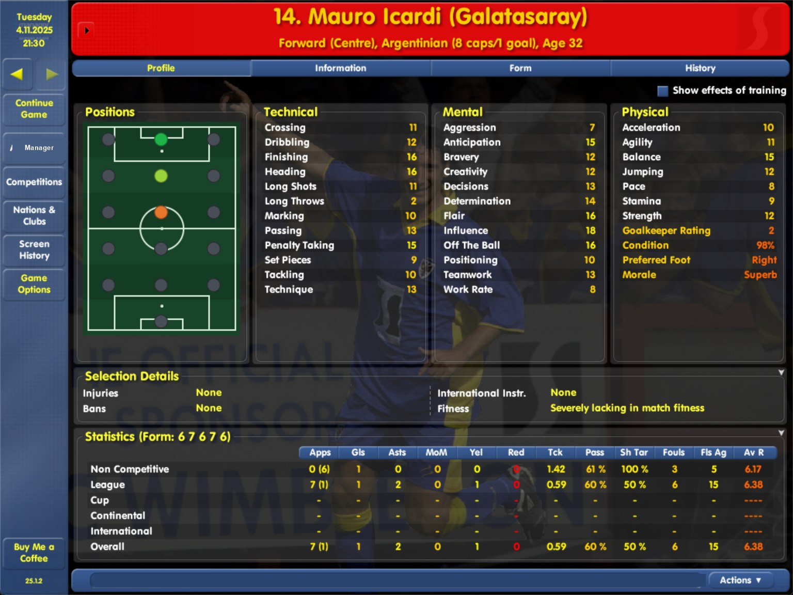

# CM 03/04 Modern

A fan-made, unofficial update that brings Championship Manager 03/04 (version 4.1.5) into the 2026/27 football world.

**Current version: 26.0.0** - [Download 26.0.0 from Releases](https://github.com/cm0304-modern/cm0304-modern/releases/tag/v26.0.0) (the 2026/27 game). The 2025/26 game is still available: [25.1.2](https://github.com/cm0304-modern/cm0304-modern/releases/tag/v25.1.2) is the newest 25.x release.

Pages: [FAQ](faq.md) | [Nations](nations.md) | [Known issues](known-issues.md) | [Update notice](update-notice.md) | [Changelog](changelog.md) | [Report a bug](report-a-bug.md) | [Screenshots](screenshots.md)

## Install guide (26.0.0, the 2026/27 game)

**Before you start**

- You need your own Championship Manager 03/04, **version 4.1.5** (updated with the official 4.1.5 patch, or a no-CD exe: any exe works), on Windows 10 or 11. The game folder must contain `cm0304.exe` and `data\db` with the four database files.
- Close the game and the editor.
- Have about 700 MB of free disk space.

**Steps**

1. Download `CM0304-Modern-26.0.0-Setup.exe` from the [release page](https://github.com/cm0304-modern/cm0304-modern/releases/tag/v26.0.0). You can check the download with PowerShell: `Get-FileHash .\CM0304-Modern-26.0.0-Setup.exe` and compare with the SHA-256 shown on the release.
2. Run the installer and accept the administrator prompt. If Windows SmartScreen says "unknown publisher", that is because the installer is not code-signed.
3. Choose the folder that contains `cm0304.exe`. Setup lists what it will change, backs up the originals to `backup_pre_v25`, installs and verifies every file.
4. Start the game and begin a **new game**. 26.0.0 is the 2026/27 game: saves from 25.x or earlier versions, or from the original game, do not work with it (they stay in your folder).

**The game starts in full screen.** 26.0.0 keeps its settings under its own name ("Championship Manager 26/27"), so the options of your 25.x or original game do not carry over and the game starts in full screen. To play in a window, open **Preferences > Display Settings** and untick **Full Screen**, or start `cm0304.exe` with the switch `-windowed`.

**The installer replaces `cm0304.exe`** with our modified executable (it carries the rule changes). Your own exe is backed up byte for byte. No CD is needed afterwards.

**Upgrading from 25.x:** run the new installer on the same game folder and **start a new game**. Nothing of your 25.x saves is deleted. If you want to keep playing 25.x as well, install 26.0.0 into a copy of your game folder (the installer works on any folder that contains `cm0304.exe`).

**Going back to 25.x:** run `Uninstall CM 03-04 26.0.0.exe` from your game folder first (it restores your original files), then run the 25.x installer. Your 25.x saves are still in `user data\games`.

If the installer refuses, it has not changed anything. It refuses only when the folder is clearly not a CM 03/04 folder, the game is running or files are not writable.

**Uninstall:** run `Uninstall CM 03-04 26.0.0.exe` from your game folder. It restores your original files (your own exe included) from the backup and then removes the backup folder and itself.

## Which version do I need? (two lines)

CM 03/04 Modern has two version lines, because the 2025/26 game and the 2026/27 game are different games:

- **26.x - the 2026/27 game** (this page's install guide): the 2026/27 season from Football Manager 27 data for 30 nations. Download it from the [v26.0.0 release](https://github.com/cm0304-modern/cm0304-modern/releases/tag/v26.0.0).
- **25.x - the 2025/26 game**: 2025/26 squads, clubs and competitions. It keeps receiving bug fixes (25.1.1 and later). Download the newest one from the [v25.1.2 release](https://github.com/cm0304-modern/cm0304-modern/releases/tag/v25.1.2); all releases are on the [Releases page](https://github.com/cm0304-modern/cm0304-modern/releases). The GitHub "latest release" link stays on the 25.x line on purpose (the update notices of older 25.x versions follow it), so use the version links on this page.

The two lines are separate games: each needs a **new game**, and saves of one line do not load in the other. They keep their settings separately. The update notice only tells you about newer versions of **your own line**: 25.x players hear about 25.x versions, 26.x players about 26.x versions. To play both, install 26.x into a copy of your game folder.

## What's new in 26.0.0

**The 2026/27 game.** Start a NEW game: saves from 25.x or earlier do not load in 26.0.0.

- **A 2026/27 world from Football Manager 27 data** for 30 nations: the 28 nations of 25.x plus **Russia and Israel**. A new game starts in July 2026 (Sunday 12 July 2026 with all 30 nations ticked). The database holds more than 140,000 players and more than 48,000 staff: squads, ratings, contracts, loans, club reputations, finances, facilities and kit colours (Alanyaspor are orange and green now). More than 3,500 players start the game on loan.
- **Russia and Israel are playable.** Russia has a 16-club Premier League and an 18-club FNL, Israel a 14-club Premier League and a 16-club Liga Leumit. Israel's clubs play in Europe; Russia sends nobody. The other 12 nations that were hidden in 25.x stay hidden, with rosters from the older Football Manager 26 data.
- **League structures of 2026/27:** Turkey's TFF 1. Lig has 20 clubs, the Welsh Cymru Premier 16, the Northern Irish Championship 16, the Russian FNL 18. Promotion and relegation of 2025/26 are applied: the first divisions hold their real 2026/27 clubs where the game has them.
- **The real 2025/26 season behind it.** First-division clubs start with their real final positions, the real 2025/26 cup winners are known to the game and the UEFA coefficients carry the real points up to 2025/26, so the 2026/27 places in the Champions League, Europa League and Conference League are worked out from real results, on the real 2026/27 UEFA calendar. A few clubs can differ from the real lists (see [known issues](known-issues.md)).
- **History up to 2025/26.** League, national cup, league cup and super cup winners of the 30 nations from 2003/04 to 2025/26 with the runner-up (and, for leagues, the third place) wherever it is certain; the European Championship 2004-2024 and World Cup 2006-2026 winners; European competition histories to 2026. The Euro 2028 and World Cup 2030 screens show their hosts (England and the Republic of Ireland; Morocco and Spain: the game shows at most two).
- **26/27 everywhere.** The window title ("Championship Manager 26/27"), the Start Menu header and the Quit hint say 26/27 and competition names follow the new data (for example Süper Lig, Premier League). Staff attributes are converted to the game's own 1-20 scale.
- **Stadiums.** The grounds of 4,283 clubs were changed to the real stadium name and capacity (for example Arsenal at the Emirates Stadium, 60,704; FC Bayern München at the Allianz-Arena, 75,000; Juventus at the Allianz Stadium, 41,507; Ajax at the Johan Cruijff ArenA, 55,500). The old stadium-move entries of the original game that concern the clubs of the 30 nations (moves scheduled for 2026-2028) are switched off in the database.
- **Staff dates.** In the database every staff contract ends after the start of the game and nobody keeps the dummy birth year 1900: more than 1,000 staff whose source page gave no age have a plausible one. The game recalculates some staff dates itself when a new game starts, so the dates on the staff screens can still differ.
- **Midfield labels.** The squad list and the player profile print one midfield label per player (defensive midfield before attacking midfield before midfield), so a weaker 'accomplished' role could hide a natural one. About 11,000 such roles in the database were lowered one step, so that the natural role is the one that is shown; the Positions pitch still draws them as accomplished (light green). About 880 natural wing-backs who had no defender position now count as defenders.
- **Carried from 25.x:** the Positions pitch of the player profile (25.1.2), the once-only European prize money and the calendar fixes of 25.1.1.
- **What did not change:** the economy (wages and prize money) is the same model as in 25.x. About 14,000 young, low-profile players have estimated attributes, because the Football Manager 27 database holds none for them until a game starts. Creating a new game with all 30 nations takes about 10 to 12 minutes on our test machine.

## Installing the 2025/26 game (25.x)

The 25.x line is unchanged by 26.0.0. Its install guide, for the newest release (25.1.2):

1. Download `CM0304-Modern-25.1.2-Setup.exe` from the [v25.1.2 release](https://github.com/cm0304-modern/cm0304-modern/releases/tag/v25.1.2), run it, choose the folder that contains `cm0304.exe`, and start a **new game** (saves from the original game or from versions before 25.1.0 do not work with 25.x; saves of 25.1.0 and 25.1.1 do).
2. **Upgrading from 25.1.1, or reinstalling:** run the new installer on the same game folder. `cm0304.exe` and the player profile screen (`data\panels\player profile.xml`) are replaced and seven pictures are added (`data\graphics\pictures\positions`); the database files and everything else stay as they are, so your **25.1.1 saves keep working** and no new game is needed. If your own player profile screen file is not the original one, it is backed up first (the uninstaller puts it back).
3. **Upgrading from 25.1.0:** the same, and the update helper `CM0304-UpdateCheck.exe` is replaced too; your **25.1.0 saves keep working** and no new game is needed (only the Argentine fix needs a new game, see "What's new in 25.1.1"). If you switched the update notice off (`update-check.disabled`), it stays off.
4. **Upgrading from 25.0.0-25.0.3:** run the new installer on the same game folder (two new data files are added: `data\db\club_coef.dat` and `data\db\ccs_extra.dat`). **Start a NEW game afterwards: saves made with 25.0.x do not load in 25.1.x.**
5. **Uninstall:** run `Uninstall CM 03-04 25.1.2.exe` from your game folder.

To go from 26.0.0 back to 25.x, run `Uninstall CM 03-04 26.0.0.exe` first, then the 25.x installer.

## What's new in 25.1.2

**The player profile now shows where a player can play.** A new **Positions** box sits to the left of the Technical (or Goalkeeping) attributes: a top-down pitch with a coloured dot for every spot a player can take (left, centre and right of the striker, attacking midfield, midfield, defensive midfield and defender rows, plus the goalkeeper). It works for every player and shows the same position ratings the game uses for the position labels in the squad list.

- **Green** = natural, **light green** = accomplished (the game picks him there), **yellow** = competent, **orange** = unconvincing, **grey** = cannot play there. A goalkeeper shows only the goalkeeper spot.
- **Hover over the pitch** for a text list, for example "Natural: AM (L, R), M (L, R). Accomplished: AM (C), M (C)" (AM = attacking midfielder, M = midfielder, DM = defensive midfielder, D = defender, ST = striker, GK = goalkeeper; L, C, R = left, centre, right).
- **Nothing else changes.** The database is identical to 25.1.1: your **25.1.1 saves keep working** and no new game is needed. The update replaces `cm0304.exe` and the player profile screen file (`data\panels\player profile.xml`) and adds seven small pictures in `data\graphics\pictures\positions`. If you had edited that screen file yourself, the installer backs your version up first and the uninstaller puts it back.

Mauro Icardi (Galatasaray, a forward): natural at striker (green), accomplished at attacking midfield (light green), unconvincing in midfield (orange), nowhere else.
## What's new in 25.1.1

**A bug-fix update of 25.1.0.** Your 25.1.0 saves keep working; no new game is needed (only the Argentine fix needs one, see below).

- **European prize money is paid once per match.** In 25.1.0 the league-phase prize money of the Champions League, Europa League and Conference League was paid several times per match when the League Table tab of the live match screen was open (every refresh of the tab paid every club of the night again, so the inbox filled with the same message). It is now paid once per match, when the match is decided; the amounts are unchanged. Matches you do not watch, or watch with that tab closed, were always paid correctly.
- **The Slovak divisions play exactly the matches they declare.** The calendars of the First Division (12 clubs, 33 matches each) and the Second Division (14 clubs, 26 matches each) had 36 and 30 dates; they now have 33 and 26 matchdays. In an existing save the current season keeps its old calendar and the next season is created with the right one.
- **A rare crash of the Serie C Cup is fixed.** In about 1 in 200 new games with Italy the knock-out stage of the Serie C Cup was built one team short and the game crashed on 10-11 September when it drew the first round. A save whose Serie C Cup was already built too short cannot be repaired.
- **The Argentine second division now completes its season.** The Primera Nacional (36 clubs) had only 21 of the 35 matchdays in its second half-season, so the division could never finish and the Argentine leagues did not move on to the next season. It now has all 35 matchdays and the Argentine leagues finish their season and move to the next one; the Argentine second division stays at 36 clubs and the Premier Division at 30.
- **The update notice stays on your version line.** It only offers newer versions of the line you have installed (25.x offers 25.x), so a separate 26.x game is never offered to a 25.x player. See [the update notice](update-notice.md).

**Argentina is fixed for new games only.** The calendar of a season is stored in the save: a save made with an earlier version keeps its old Argentine second-division calendar, in that save the division still cannot complete its season and the Argentine leagues stay stuck. Start a new game for the corrected structure.

Not repaired: money that a 25.1.0 save already received through the prize-money bug stays in that save. Until you update, do not open the League Table tab of the match screen during a live European league-phase match.

## What's new in 25.1.0

**The three European competitions now follow the modern UEFA formats.** Start a NEW game: saves from 25.0.x do not load in 25.1.0.

- **Champions League, Europa League and Conference League** each play a 36-club league phase (Swiss-system draw with pots; 8, 8 and 6 matchdays) with the real tie-break order. The best 8 go straight to the round of 16, places 9 to 24 play a knockout play-off round, then quarter-finals, semi-finals and the final. No away-goals rule. The Super Cup is played between the Champions League and Europa League winners.
- **Qualifying paths.** Each competition has a main path and a champions path, and clubs that lose in qualifying drop into the next competition's qualifying or league phase, like in the real game. The rounds are listed one column per round on the competition screens, with the path named (Champions Path / League Path / Main Path); the draw message arrives once per draw and "View draw" opens that round.
- **Who gets in is calculated from the real world.** A new game starts from the real 2024/25 season end (league positions and domestic cup winners decide the 2025/26 places). At every season rollover the number of clubs each association sends to each round is worked out from the association coefficients (the five seasons before the closing one), with the European Performance Spots and the title-holder rules. Associations without a selectable league do not send clubs.
- **UEFA coefficients.** Real association coefficients 2020/21 to 2024/25 and the 2024+ points rule; the UEFA Coefficients screen shows the new values. A new screen, **UEFA Club Coefficients** (Competitions > Europe), lists the top 200 clubs over the last five seasons with the total.
- **European prize money** follows the 2026/27 UEFA distribution (scaled by 0.75): participation fees, win and draw bonuses, league-phase ranking, knockout rounds and the Super Cup, paid through your club's normal finances.
- **History and looks.** European competition histories from 2004 to 2025 (the Conference League from 2022), the new competition and round names, a picture for each competition in the title bar of its screen, and fixed header colours (dark blue, orange, green) instead of the last winner's colours.
- **Squad registration** for the European qualifying rounds works from the first round: the first deadline is before the first qualifying round, and a game that starts after it asks for your squad list on the first day.

Known gaps: the value pillar of the UEFA distribution is not modelled, some provisional marks in the league-phase tables appear only for clinched positions, and a few tie-break details are simplified. See [known issues](known-issues.md).
## What came with 25.0.3

- **The game runs faster.** A type-cast cache and a history-file handle cache sit in a small replacement of the game's own runtime library. In our tests this made the transfer window about 1.4 times faster. The game data is unchanged, so your 25.0.x saves keep working.
- The installer now also puts three small files in your game folder: `msvcr71.dll` (the speed-up, your own file is backed up first), `MSVCR71_real.dll` (your original runtime, kept because the speed-up forwards to it) and `cm_proxy.cfg` (optional settings). The uninstaller puts your own file back. See the [FAQ](faq.md) for how to switch the speed-up off.

## What came with 25.0.2

- **A friendly "new version" notice.** When you start the game, a small helper looks at this project's releases page, at most once a day. If a newer version is out, a short window tells you and asks whether you want to open the download page. Nothing is downloaded or changed for you, and nothing about you or your game is sent.
- **You are in control.** The installer has a box "Check for updates when the game starts". Untick it and the notice never appears. You can also switch it off later. Details: [the update notice](update-notice.md).
- The game data is the same as in 25.0.1, so your 25.0.x saves keep working.
- Note: the installer now also puts a small program, `CM0304-UpdateCheck.exe`, in your game folder. It is not code-signed, so antivirus or Windows may mention it. It is safe to delete (see [known issues](known-issues.md)).

## What came with 25.0.1

- Friendly matches allow 12 substitutions again (25.0.0 limited them to 5 by mistake).
- The 2D match speed option now really controls the pace.
- The installer now works with the official 4.1.5 exe (25.0.0 refused it) and with no-CD exes; reinstalling and uninstalling work cleanly. You can install it straight over 25.0.0.

## What came with 25.0.0

- A real 2025/26 world built from Football Manager 26 data: about 148,000 players and about 47,000 staff, with current club names, stadiums and finances.
- 28 nations with real 2025/26 divisions and cups (see [nations](nations.md)).
- Modern squad rules: 12 named players and 5 substitutes used.
- 2025/26 foreign-player limits per nation, updated EU flags, national-team managers.
- African Cup of Nations and year-related fixes.
- A Contributors screen.

The full list is in the [changelog](changelog.md). Please also read the [known issues](known-issues.md).

## Support

Bugs and requests: [GitHub Issues](https://github.com/cm0304-modern/cm0304-modern/issues/new/choose). Tips on what to include: [report a bug](report-a-bug.md).

*Fan-made and unofficial. Not affiliated with or endorsed by the original developers or publishers. The installer contains a modified game executable and data files, and no other game files.*
