# Screenshots

Taken in version 25.0.0 at the start of a new game (13 July 2025). The manager name has been hidden.

## League table

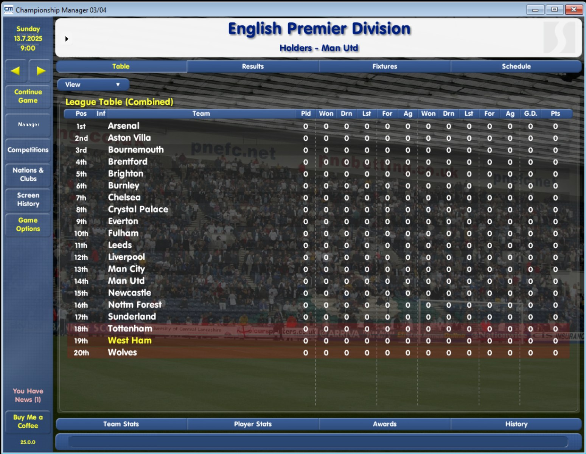

The English Premier Division with 20 clubs, including the newly promoted sides. ("Holders" still shows the 2003/04 champions: club and competition histories are not updated yet, see [known issues](known-issues.md).)

## Squads

| | |
|---|---|
| 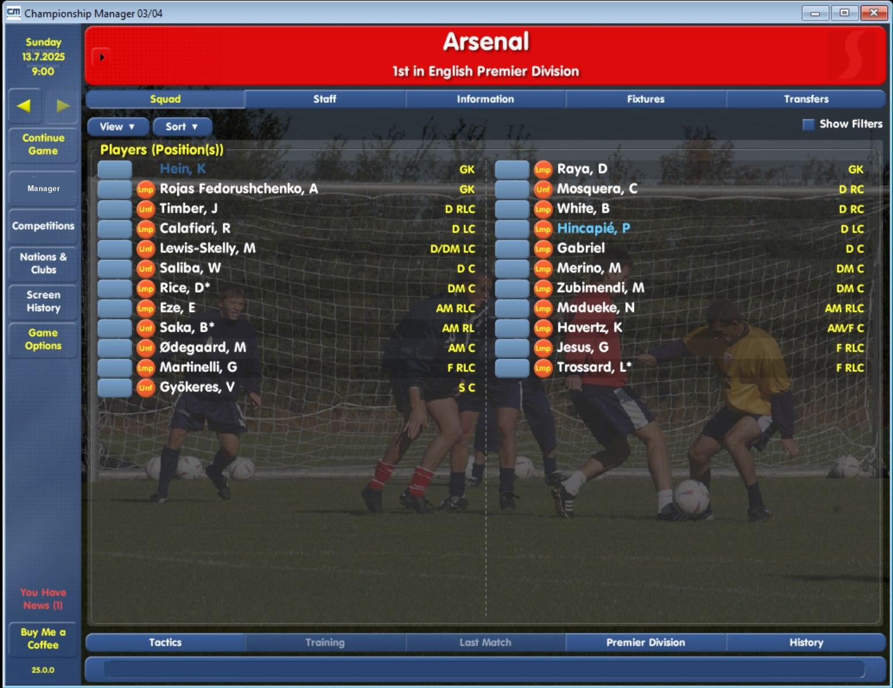 | 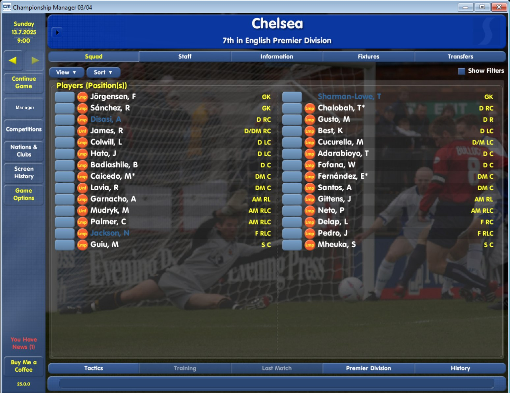 |
| Arsenal | Chelsea |
| 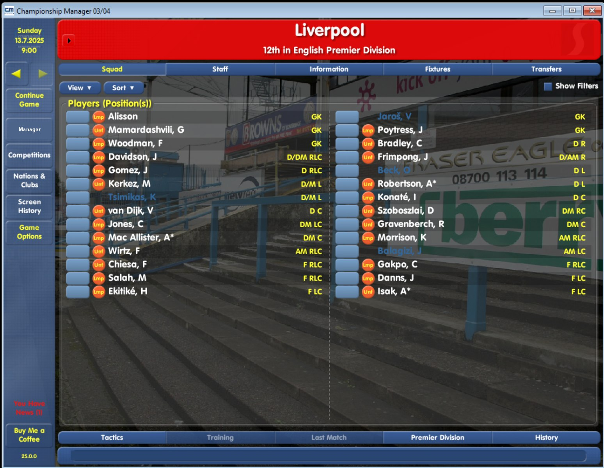 | 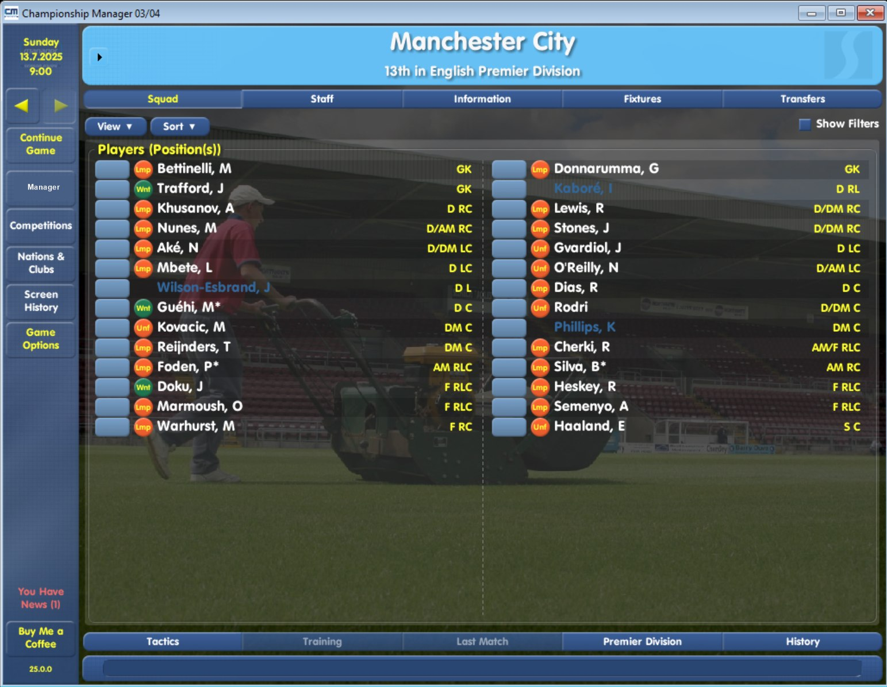 |
| Liverpool | Manchester City |

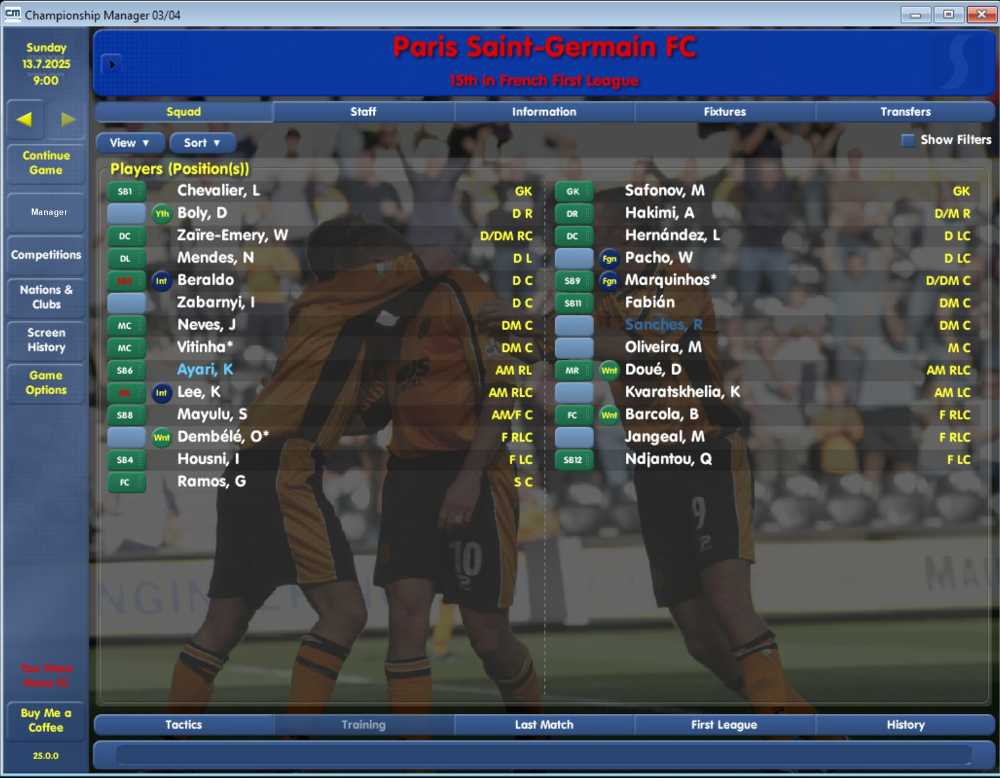

Paris Saint-Germain in the French First League.

## Player profiles

| | |
|---|---|
| 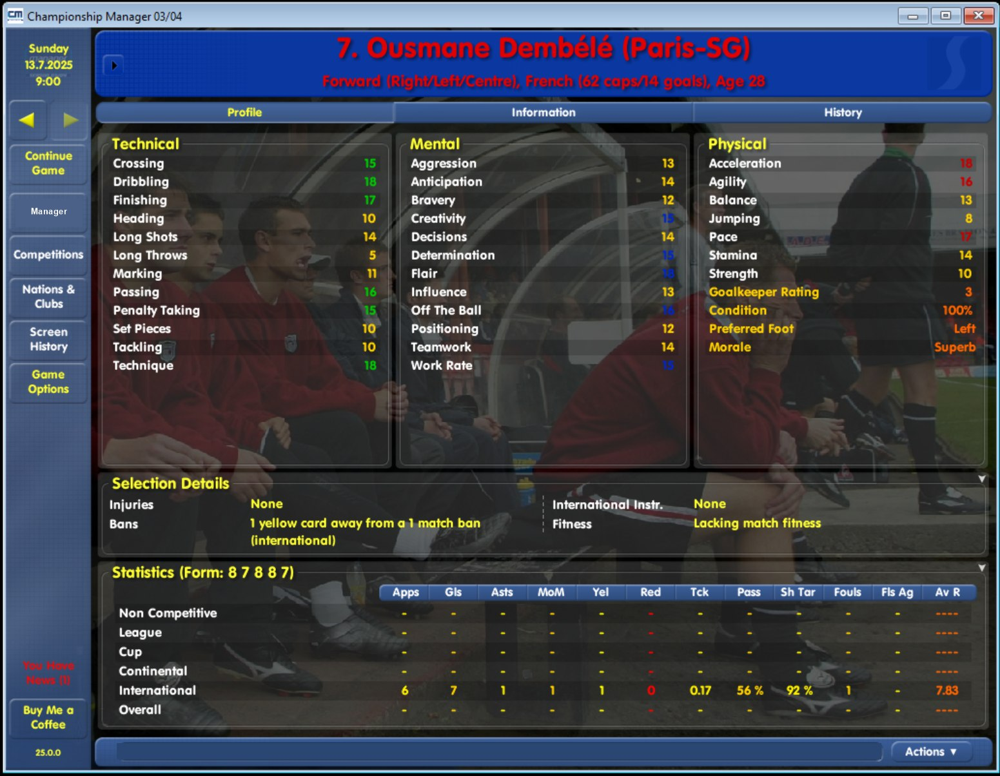 | 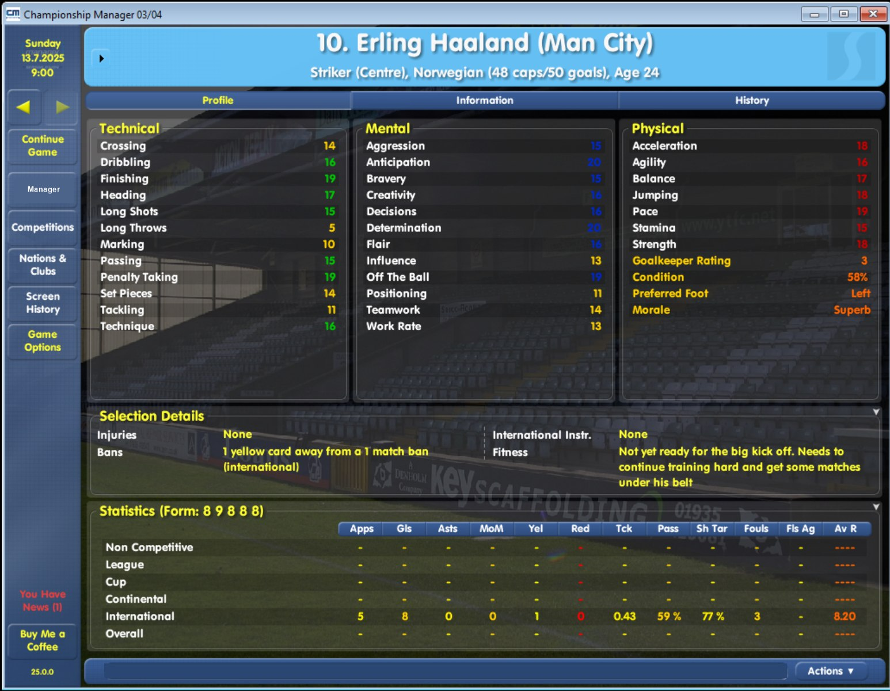 |
| Ousmane Dembele (Paris-SG) | Erling Haaland (Man City) |
| 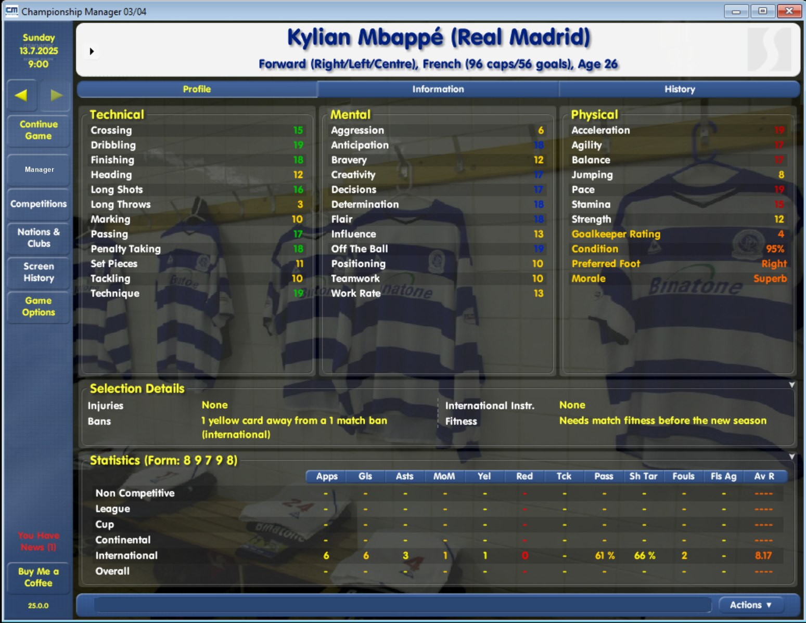 | 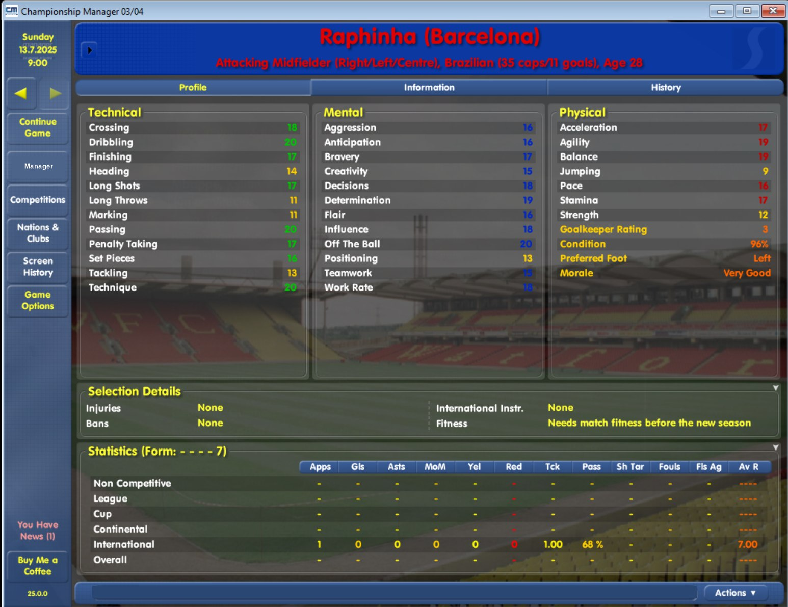 |
| Kylian Mbappe (Real Madrid) | Raphinha (Barcelona) |

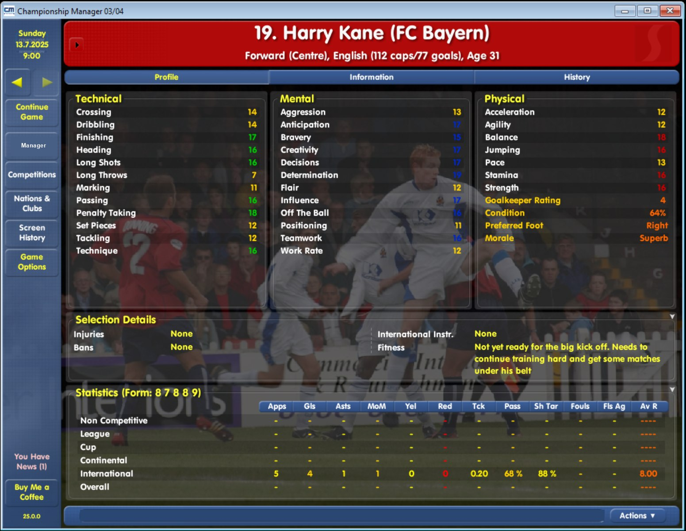

Harry Kane (FC Bayern), with international caps and goals.

## Still to come

- [ ] New-game screen showing the selectable nations
- [ ] A club info screen with stadium and finances
- [ ] The Contributors screen
- [ ] The installer's folder page and success page
- [ ] A fixture list for a non-English nation (for example Belgium)
